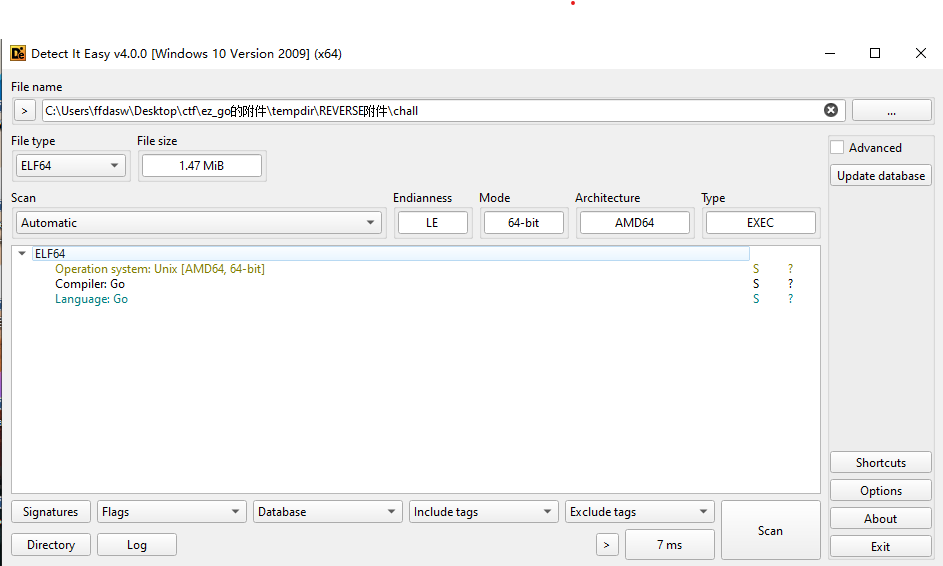
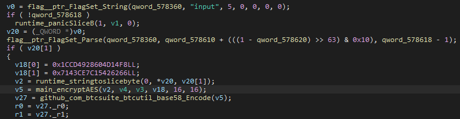
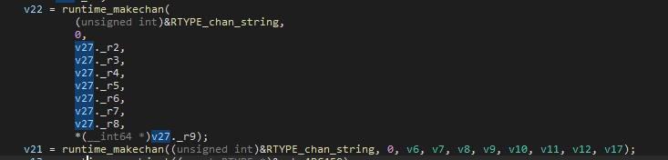
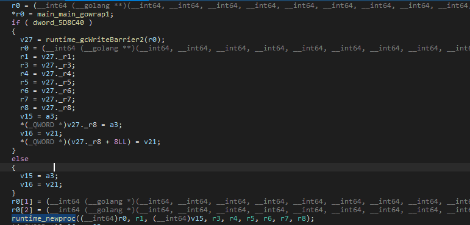
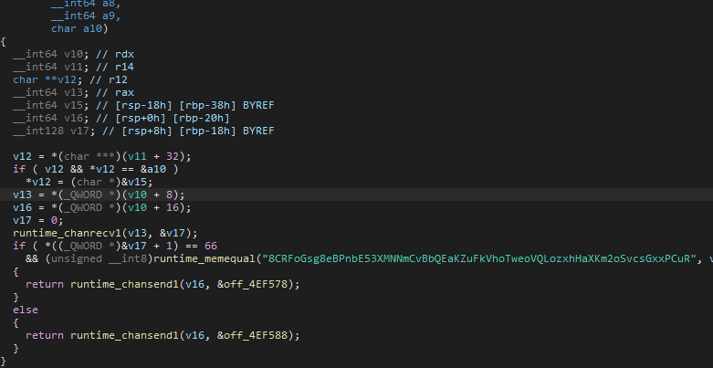
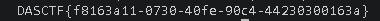

# ez_go
> 比赛：浙江省大学生CTF 2026
> 类别：Reverse
> 难度：Easy
> 考点：AES加密 base58编码
> flag：`DASCTF{f8163a11-0730-40fe-90c4-44230300163a}`

## 壳检测
DIE检测有无壳

使用go语言编写,无壳

## 题目描述
题目将输入的值先进行AES加密,再通过base58编码,与内置的结果对比
由此可知flag通过内置的值先base58解码再进行AES解密得到

主函数里没有找到内置结果
但是他使用base58后的值进行了makechan

程序一共使用了两个makechan
并作为值传进了main_main_gowrap1里

点进main_main_gowrap1立刻发现了memequal函数
里面直接写着比较的值

前面加密部分他的AESkey也写在函数里
由此我们编写解密脚本得出flag



## EXP
```python
import base58
from Crypto.Cipher import AES
from Crypto.Util.Padding import unpad

def aes_decrypt(key: bytes, ciphertext: bytes) -> bytes:
    cipher = AES.new(key, AES.MODE_ECB)
    plaintext = cipher.decrypt(ciphertext)
    return plaintext

if __name__ == '__main__':

    key=[0x1CCD4928604D14F8,0x7143CE7C15426266]
    aes_key=key[0].to_bytes(8,"little")+key[1].to_bytes(8,"little")
    print(aes_key)
    cipher_text="8CRFoGsg8eBPnbE53XMNNmCvBbQEaKZuFkVhoTweoVQLozxhHaXKm2oSvcsGxxPCuR"
    cipher_text1=base58.b58decode(cipher_text)
    plain_text=aes_decrypt(aes_key, cipher_text1).decode('utf-8', errors='ignore')
    print(plain_text)
