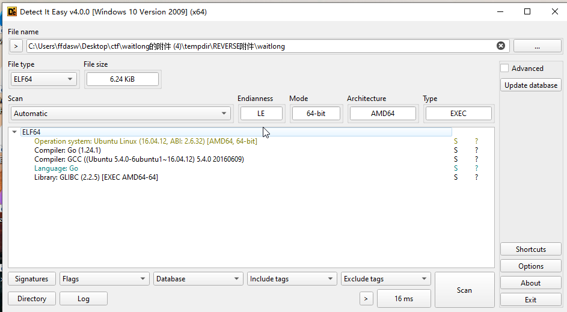
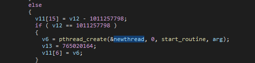
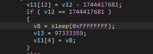
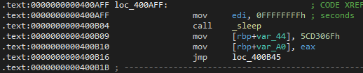
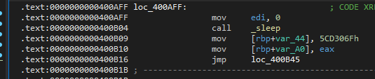
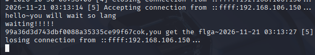
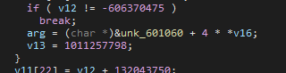
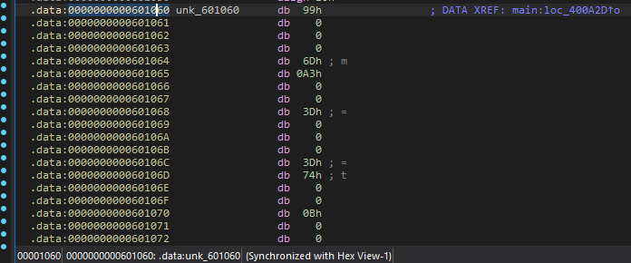

# waitlong

> 比赛：浙江省大学生CTF 2026

> 类别：Reverse

> 难度：Easy

> 考点：无限等待

> flag：`3be3d535c9967c99ff00743d88a3a36d`

## 壳检测

DIE检测有无壳



使用go语言编写,无壳

## 题目描述

题目通过循环创建线程



线程里存在usleep,他把传入的数作为参数,后面接一个printf以16进制打印该数字
所以该题的流程为从小到大打印一个数组里的数作为flag

但是题目中存在一个`sleep(-1)`会导致无限等待,把里面的值补丁成0







正常来说远程调试直接可以在控制台获取flag,但是我们获取到的flag提交是错误的
控制台提供的错误flag:99a36d3d743dbf0088a35335ce99f67c



看线程创建传入的参数变量名为arg,我们去ida里找arg的赋值,发现他是通过0x601060这个地址加偏移的取值,也就是一个DWORD数组



把数组值抄下来



通过python脚本进行排序,将拿到的值作为flag提交


## EXP

```python
IDA_601060=[0x99,0xa36d,0x3d,0x743d,0xb,0xf00,0x88a3,0x53,0x3,0x5c,0xe,0x99f,0x67c]
flag_array=sorted(IDA_601060)
for i in flag_array:
    print(hex(i)[2::],end="")